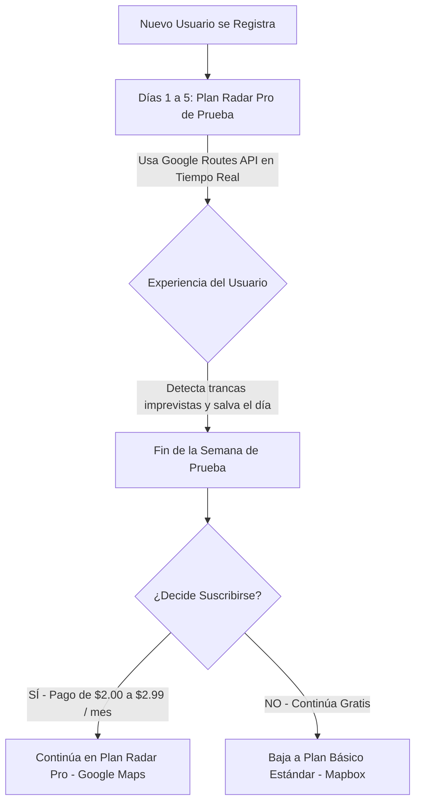

# 🚀 Esquema de Negocio: Alerta-Tráfico (Micro-SaaS)

> **Documento Estratégico de Modelo de Negocio, Unit Economics y Hoja de Ruta**  
> *Versión 1.0 — Proyecto Alerta-Tráfico*

---

## 1. Resumen Ejecutivo y Propuesta de Valor

### El Problema
En ciudades con alto congestionamiento y tráfico impredecible (por ejemplo, la Gran Caracas y principales arterias viales como la Autopista Gran Mariscal de Ayacucho, Carretera Petare-Guarenas, Panamericana o Prados del Este):
* El tráfico no es constante: un choque, una gandola accidentada, lluvia o una alcabala a las 6:30 AM puede duplicar o triplicar el tiempo de viaje.
* La gente tiene que levantarse a mirar manualmente Google Maps o Waze antes de bañarse o cambiarse, o arriesgarse a llegar tarde al trabajo, perder bonos de puntualidad o recibir sanciones.
* Las soluciones existentes (alarmas de Waze o Google Calendar) fallan con frecuencia porque el sistema operativo del teléfono las "mata" en segundo plano para ahorrar batería.

### La Solución
**Alerta-Tráfico:** Una Progressive Web App (PWA) con un motor inteligente en la nube que calcula de forma dinámica y desatendida la hora exacta de salida:
$$\text{Hora de Alarma} = \text{Hora Deseada de Llegada} - \text{Tráfico en Tiempo Real} - \text{Margen de Preparación}$$
El usuario solo programa su hora de entrada y su margen personal; la aplicación vigila el tráfico por él mientras duerme y le dispara una notificación sonora Push en el instante quirúrgico en que debe comenzar a prepararse.

---

## 2. Estrategia de Producto: Freemium con Prueba Inversa (*Reverse Trial*)

Para maximizar la adquisición de usuarios, minimizar los costos operativos y garantizar una alta tasa de conversión, se adopta el modelo **Freemium con Prueba Inversa**:



### Nivel 1: Plan Básico (100% Gratuito)
* **Motor:** **Mapbox Directions API** (`mapbox/driving-traffic`).
* **Características:**
  * Estimación de ruta y tiempo de viaje con tráfico promedio/histórico.
  * Notificaciones Web Push diarias.
  * Costo para la plataforma: **\$0 USD** (gracias a la cuota gratuita de 100.000 peticiones mensuales de Mapbox).
* **Propósito:** Actúa como embudo de captación masivo y mantiene a los usuarios dentro del ecosistema sin generar pérdidas financieras.

### Nivel 2: Plan Radar Pro (Suscripción Premium)
* **Motor:** **Google Maps Platform** (*Routes API* con `TRAFFIC_AWARE` y datos de Waze / Android).
* **Características:**
  * Detección de atascos, accidentes y alcabalas al minuto exacto.
  * Alta frecuencia de sondeo adaptativo en la ventana matutina.
  * Soporte para múltiples paradas o rutas alternativas.
* **Precio sugerido:** **\$2.00 a \$2.99 USD/mes** (pagaderos en Bolívares vía Pago Móvil al cambio oficial, o Binance USDT).

### El Gancho: La Semana de Prueba (*Reverse Trial*)
* Todo usuario nuevo recibe automáticamente **5 días laborales (de lunes a viernes)** de Plan Radar Pro impulsado por Google Maps.
* Durante esa semana, el usuario experimenta la tranquilidad de que la alarma reacciona en vivo a las trancas de la mañana.
* Al expirar el periodo de prueba, el sistema le notifica que ha pasado al Plan Básico y le ofrece mantener la precisión de Google Maps por menos de lo que cuesta un café al mes.

---

## 3. Análisis de Costos y *Unit Economics*

### Capas Gratuitas de Proveedores de Mapas
| Proveedor | Cuota Gratuita Mensual | Costo Excedente | Calidad en Venezuela |
| :--- | :--- | :--- | :--- |
| **Google Maps (Routes API)** | **\$200 USD de crédito/mes** (~20.000 consultas con tráfico) | \$10.00 por cada 1.000 consultas (\$0.01 / consulta) | ⭐️⭐️⭐️⭐️⭐️ Insuperable (Android + Waze) |
| **Mapbox (`driving-traffic`)** | **100.000 consultas/mes** | \$2.00 por cada 1.000 consultas (\$0.002 / consulta) | ⭐️⭐️⭐️⭐️ Muy buena en autopistas; histórica en calles secundarias |

### Consumo de Consultas por Usuario
Gracias al **algoritmo de sondeo adaptativo** desarrollado en el backend:
* **Tarde / Noche:** 0 consultas (servidor en reposo).
* **Ventana matutina (90 a 45 min antes):**
  * Lejos de la salida: cada 15 min ($\approx$ 3 consultas).
  * Acercándose: cada 5 min ($\approx$ 3 consultas).
  * Tramo final crítico: cada 2 min ($\approx$ 3 a 4 consultas).
  * **Al disparar la alarma:** Se detiene de inmediato.
* **Promedio diario:** **~9 a 10 consultas por día laboral**.
* **Promedio mensual (22 días hábiles):** **~220 consultas al mes por usuario**.

---

## 4. Viabilidad Financiera y Proyecciones

### Escenario 1: Fase Inicial (0 a 80 Usuarios)
* **Estrategia:** Todos los usuarios en Google Maps Routes API.
* **Consumo mensual:** $80 \times 220 = 17.600$ consultas.
* **Factura de Google:** \$176 USD (Totalmente cubierta por el crédito gratis de \$200 USD de Google).
* **Costo de infraestructura:** **\$0.00 USD**.

### Escenario 2: Modelo Híbrido (500 Usuarios Totales)
* **Composición:**
  * 420 usuarios en Plan Gratuito (Mapbox).
  * 30 usuarios en periodo de prueba de 5 días (Google Maps).
  * 50 usuarios suscritos a Plan Radar Pro a \$2.99 USD/mes (Google Maps).
* **Ingresos:**
  * $50 \times \$2.99 = \mathbf{\$149.50\text{ USD / mes}}$.
* **Costos de APIs:**
  * **Mapbox:** 420 usuarios $\times$ 220 consultas = 92.400 consultas (dentro de las 100.000 gratis) = **\$0.00 USD**.
  * **Google Maps:** 
    * 50 usuarios Pro: 11.000 consultas.
    * 30 usuarios de prueba (5 días c/u): ~1.500 consultas.
    * Total Google: 12.500 consultas = \$125 USD (cubierto por el crédito gratis de \$200 USD) = **\$0.00 USD**.
* **Ganancia Neta:** **\$149.50 USD / mes (100% de margen operativo)**.

### Escenario 3: Escala a 1.000 Usuarios (150 Usuarios Pro)
* **Ingresos:** $150 \times \$2.99 = \mathbf{\$448.50\text{ USD / mes}}$.
* **Costos:**
  * Mapbox (850 usuarios gratis): ~187.000 consultas $\to$ 87.000 excedentes $\times$ \$0.002 = **\$174.00 USD**.
  * Google Maps (150 Pro + pruebas): ~35.000 consultas $\to$ \$350 USD - \$200 (crédito) = **\$150.00 USD**.
  * Servidor VPS en la nube (DigitalOcean / Hetzner): **\$5.00 USD**.
* **Costos Totales:** \$329.00 USD.
* **Ganancia Neta:** **\$119.50 USD / mes** (ampliable optimizando la frecuencia de consulta a 45 min para duplicar el margen a más de \$280 USD limpios).

---

## 5. Hoja de Ruta Técnica para la Fase de Negocio

Para transformar el prototipo personal en una plataforma comercial multi-usuario, se deben implementar las siguientes fases:

### Fase A: Autenticación y Gestión Multi-Inquilino
1. **Base de Datos Ligera:** Migrar de `data/config.json` a una base de datos relacional (SQLite con Prisma o PostgreSQL).
2. **Registro de Usuarios:** 
   * Autenticación por correo electrónico o Magic Link / WhatsApp OTP.
   * Evitar trampas de pruebas múltiples registrando el identificador del dispositivo (Fingerprint) o validación de número telefónico.
3. **Roles en Base de Datos:** Campo `tier: 'free' | 'trial' | 'pro'` y `trial_expires_at: DateTime`.

### Fase B: Despachador Inteligente de Tráfico (*Smart Traffic Dispatcher*)
* Implementar un conmutador de proveedores:
  ```javascript
  async function getCommuteTime(user, origin, destination) {
    if (user.tier === 'pro' || user.isTrialActive()) {
      return await fetchGoogleRoutesLiveTraffic(origin, destination);
    } else {
      return await fetchMapboxTraffic(origin, destination);
    }
  }
  ```

### Fase C: Pasarela de Pagos Localizada
* Integración de pagos accesibles en Venezuela y Latinoamérica:
  * **Pago Móvil / Transferencia Bancaria (Bs):** Automatizable vía APIs bancarias o pasarelas locales.
  * **Criptomonedas / Dólares:** Integración con Binance Pay / Zinli / Wally Tech / Lemon Cash.
  * **Internacional:** Stripe o Paddle para usuarios fuera de Venezuela.

---

## 6. Conclusión
El proyecto **Alerta-Tráfico** no solo resuelve un problema crítico de calidad de vida y puntualidad, sino que posee una arquitectura de costos sumamente favorable:
1. Permite iniciar operaciones comerciales a **costo cero**.
2. Aprovecha los \$200 mensuales de Google Maps como capital semilla de infraestructura.
3. Escala la masa de usuarios con la generosa capa gratuita de Mapbox.
4. Monetiza mediante un modelo de prueba irresistible que demuestra su valor en la primera semana de uso.
